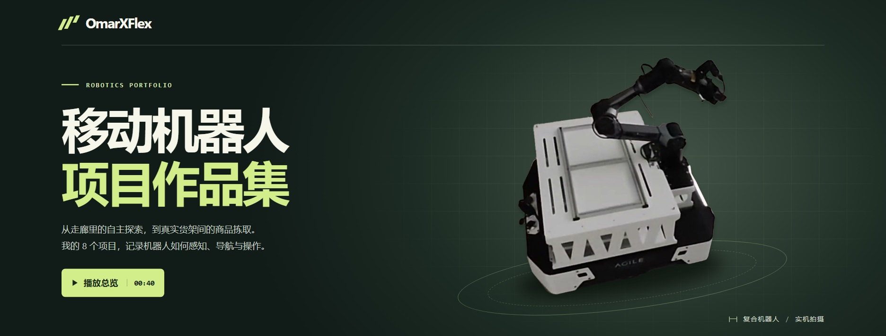
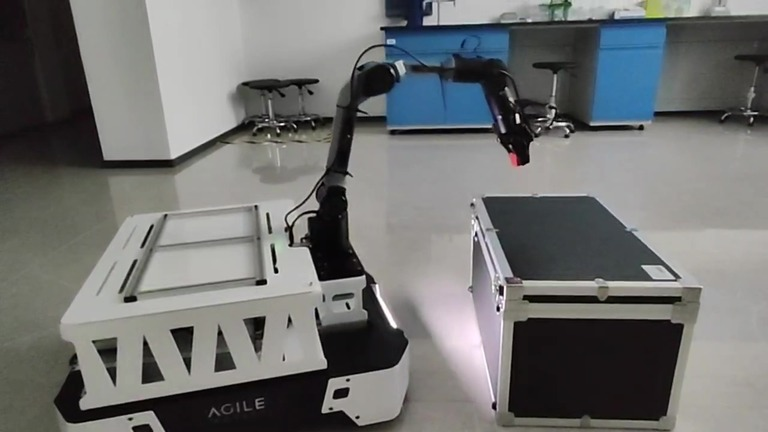
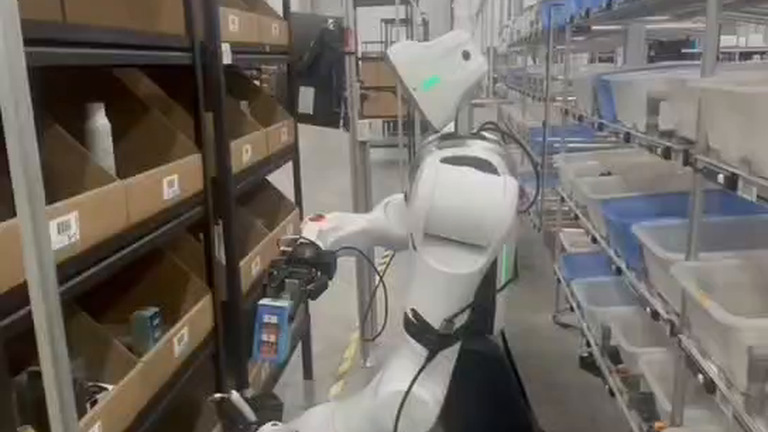
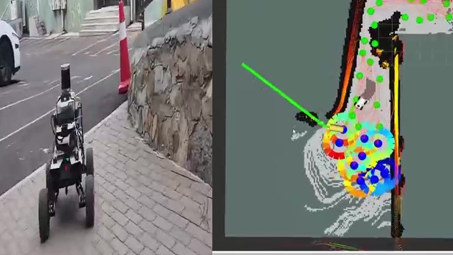
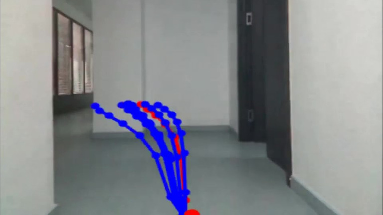
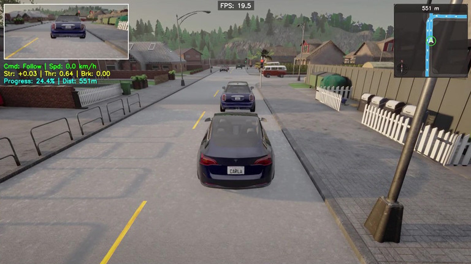
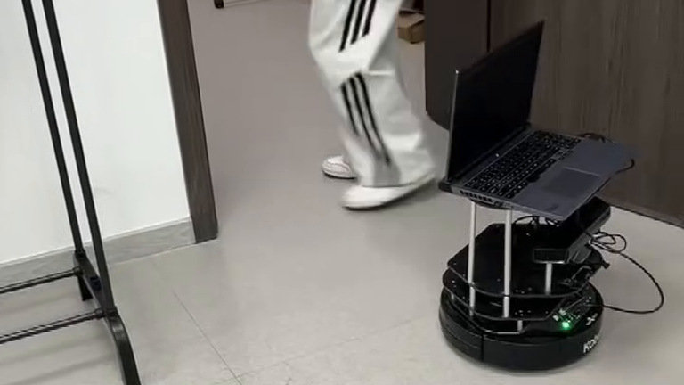
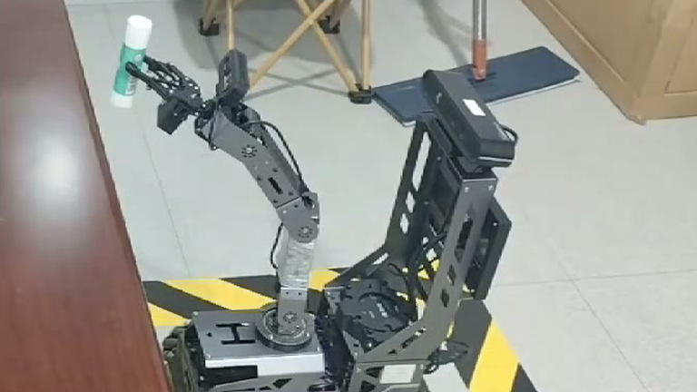
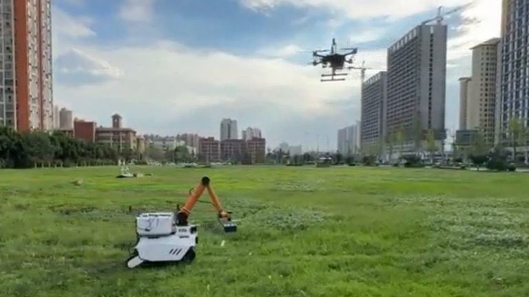

<a href="assets/showreel.mp4"><picture><source media="(max-width: 600px)" srcset="assets/hero-mobile.jpg"></picture></a>

**[播放 40 秒项目总览](assets/showreel.mp4)**

[移动操作](#移动操作) · [自主探索](#自主探索) · [驾驶感知与跟随](#驾驶感知与跟随) · [任务调度与平台协同](#任务调度与平台协同)

## 移动操作

<table>
<tr>
<td width="42%"></td>
<td valign="middle">
<h3><a href="assets/demos/mobile-manipulator.mp4">复合机器人导航抓取</a></h3>

用 SLAM Toolbox 建图，由 Nav2 引导底盘到达工作台。底盘停稳后，机械臂夹起红色方块。

实验室实机 · 15 秒
</td>
</tr>
<tr>
<td width="42%"></td>
<td valign="middle">
<h3><a href="assets/demos/warehouse.mp4">上海浦东免税仓拣取</a></h3>

机器人沿货架通道驶到拣货位，机械臂从纸箱中夹出盒装商品，再转向对侧的蓝色料箱。

仓库实机 · 24 秒
</td>
</tr>
</table>

## 自主探索

<table>
<tr>
<td width="42%"></td>
<td valign="middle">
<h3><a href="assets/demos/language-nav.mp4">有记忆的语言指令导航</a></h3>

仿真中，机器人用前沿探索寻找指令中的 NASA 标志，遇阻后借助地图记忆退回岔路。室外实机同步更新导航地图。

仿真与实机 · 31 秒
</td>
</tr>
<tr>
<td width="42%"></td>
<td valign="middle">
<h3><a href="assets/demos/reactive-nav.mp4">无记忆的视觉导航</a></h3>

用 Transformer 和扩散模型根据当前相机画面生成局部候选轨迹。进入转角时，轨迹随视野向左展开。

实机视角 · 14 秒
</td>
</tr>
</table>

## 驾驶感知与跟随

<table>
<tr>
<td width="42%"></td>
<td valign="middle">
<h3><a href="assets/demos/driving-perception.mp4">CARLA 模仿学习驾驶</a></h3>

项目关注车道线、信号灯和前车感知。演示中，车辆沿车道接近前车，在红灯路口减速停稳。

城市道路仿真 · 13 秒
</td>
</tr>
<tr>
<td width="42%"></td>
<td valign="middle">
<h3><a href="assets/demos/yolo-follow.mp4">YOLO11 行人跟随与避障</a></h3>

底盘用 YOLO11 检测行人。行人在室内改变方向、走向门边时，底盘也随之转向。

室内实机 · 10 秒
</td>
</tr>
</table>

## 任务调度与平台协同

<table>
<tr>
<td width="42%"></td>
<td valign="middle">
<h3><a href="assets/demos/openclaw.mp4">OpenClaw 取物任务调度</a></h3>

OpenClaw 调度导航、识别和抓取任务。机器人到茶几前夹起绿色瓶子，带回黄黑标记的起始区。

室内实机 · 21 秒
</td>
</tr>
<tr>
<td width="42%"></td>
<td valign="middle">
<h3><a href="assets/demos/gnss-coordination.mp4">GNSS 空地平台协同</a></h3>

无人机飞过草地，履带机器人在同一场地行驶。地面站集中显示两个平台的画面与状态。

户外实机 · 5 秒
</td>
</tr>
</table>
